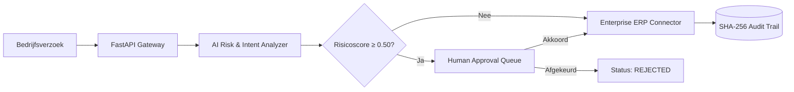

# Enterprise AI Workflow Manager

[](tests/)
[](.replit)
[](https://linkedin.com)
[](docs/ARCHITECTURE.md)

Een productieklare, geauditeerde webapplicatie en workflow-engine die ongestructureerde bedrijfsverzoeken vertaalt naar veilige, geautomatiseerde werkstromen met **Human-in-the-Loop (HITL)** fiattering en cryptografische traceerbaarheid.

Ontworpen als referentie-implementatie voor **Replit Builder Certification (Level 4 — Advanced Builder)** en **LinkedIn Connected Apps**.

---

## 🏛️ Belangrijkste Eigenschappen

- **AI Intent & Impact Reasoning:** Automatische classificatie van inkomende verzoeken en dynamische risicoscore-berekening.
- **Human-in-the-Loop Governance:** Financiële en operationele drempels blokkeren destructieve API-mutaties tot een bevoegd menselijk akkoord is geregistreerd.
- **Onveranderlijk Audit Logboek:** Elke statuswijziging, LLM-redenering en gebruikersactie wordt cryptografisch vastgelegd met SHA-256 checksums.
- **PostgreSQL Datalaag:** Enterprise-datamodel met tabellen voor workflows, stappen, fiatteringen en RBAC-rollen (zie [`docs/SCHEMA.sql`](docs/SCHEMA.sql)).
- **Replit & Cloud Native:** Direct uitvoerbaar lokaal en met 1 klik te deployen via de meegeleverde [`.replit`](.replit)-configuratie.

---

## 📊 Architectuur



Raadpleeg [`docs/ARCHITECTURE.md`](docs/ARCHITECTURE.md) voor de volledige architectuurspecificatie en systeemdiagrammen.

---

## 🚀 Snelle Start

### 1. Vereisten
- Python 3.11+
- Git

### 2. Installatie & Testen

```bash
# Clone de repository
git clone https://github.com/phlppgdfry/enterprise-ai-workflow-manager.git
cd enterprise-ai-workflow-manager

# Installeer afhankelijkheden
make install

# Voer de geautomatiseerde testsuite uit
make test

# Start de API-server
make run
```

De interactieve OpenAPI-documentatie is direct beschikbaar op `http://localhost:8000/docs`.

---

## 🎓 Certificering & Portfolio Koppeling

Dit project dekt de vijf officiële niveaus van het **Replit Builder Certification**-programma:

- 🟢 **Level 1 (Beginner Builder):** Georganiseerde workspace, gedocumenteerde API, `.replit`-configuratie.
- 🔵 **Level 2 (Core Builder):** Relationeel PostgreSQL datamodel, persistente status, gestructureerde prompts.
- 🟣 **Level 3 (Proficient Builder):** REST API-integraties, foutafhandeling, rate-limiting & middleware.
- 🟠 **Level 4 (Advanced Builder):** End-to-end HITL workflow governance, geautomatiseerde testsuite, observability.
- 🏆 **Level 5 (Master Builder):** Herbruikbare enterprise-architectuur en open governance-standaarden.

Zie [`CERTIFICATION_ROADMAP.md`](CERTIFICATION_ROADMAP.md) voor de volledige koppelingsgids naar LinkedIn Connected Apps en [`CREDITS_AND_EXECUTION_LOG.md`](CREDITS_AND_EXECUTION_LOG.md) voor het actuele uitvoerings- en sessielogboek.

---

## 📄 Licentie
MIT License — Philippe Godfroy
