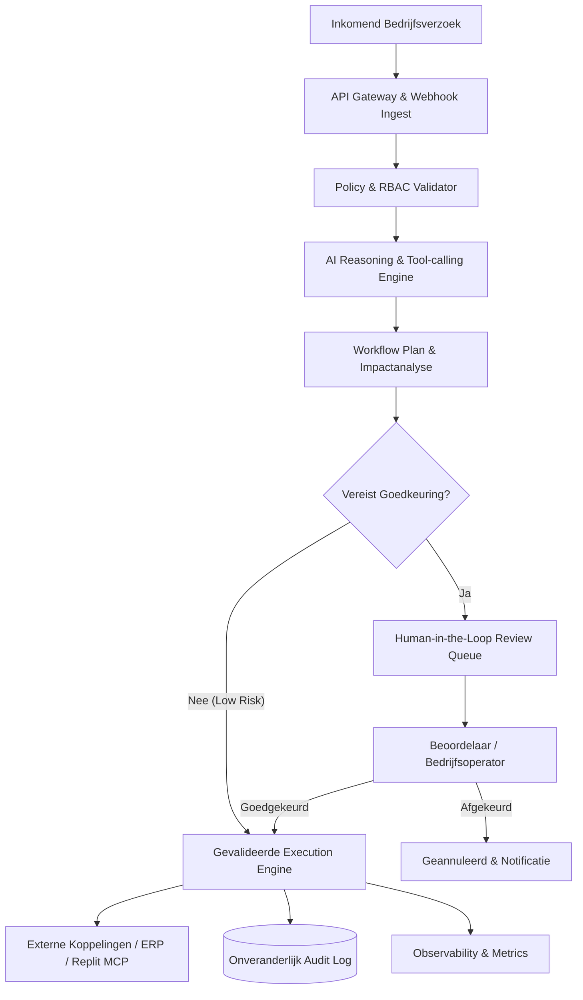

# 🏛️ Architectuur & Systeemontwerp: Enterprise AI Workflow Manager

## 1. Doel & Context

De **Enterprise AI Workflow Manager** is een productieklare webapplicatie die ongestructureerde bedrijfsverzoeken (e-mails, tickets, API-aanroepen) omzet in veilige, traceerbare en geautomatiseerde werkstromen. 

Het systeem combineert AI-redeneervermogen met strikte **Human-in-the-Loop** (HITL) controle: gevoelige acties (transacties, mutaties, verzendingen) kunnen nooit door een AI-agent worden uitgevoerd zonder een cryptografisch gelogd menselijk akkoord.

---

## 2. Componenten

### A. Frontend (UI/UX)
- **Technologie:** React 18, Vite, Tailwind CSS, Lucide Icons.
- **Modules:**
  - *Dashboard:* KPI-overzicht (doorlooptijd, automatisatiegraad, kosten, foutpercentages).
  - *Workflow Builder:* Visuele weergave van stappen en afhankelijkheden.
  - *Approval Queue:* Directe weergave van openstaande menselijke goedkeuringen met side-by-side diff en impactvoorspelling.
  - *Audit Explorer:* Tijdlijn van uitgevoerde acties met prompt-traces, tokenverbruik en gebruikersacties.

### B. Backend & Workflow Engine
- **Technologie:** Python FastAPI (async, high-throughput) met SQLAlchemy 2.0 / Pydantic V2.
- **State Machine:**
  - `SUBMITTED` → `ANALYZING` → `NEEDS_APPROVAL` → `APPROVED` → `EXECUTING` → `COMPLETED` / `FAILED`.
- **Veiligheid & Guardrails:**
  - Strikte scheiding tussen niet-destructieve queries (leesacties) en destructieve mutaties (schrijfacties).
  - Prompt-injectie detectie en contractvalidatie op alle JSON schema's.

### C. Datalaag (PostgreSQL)
- Relationele integriteit met foreign keys, indexen op status & tijdstempels, en JSONB voor dynamische workflow-parameters.
- Volledig SQL-schema beschikbaar in `docs/SCHEMA.sql`.

---

## 3. Observability & Kostenbewaking
- Registratie van LLM tokenverbruik en responstijden per stap.
- Export van statusgegevens naar JSONL voor continue evaluatie (zie `ai-mastery-lab` normen).
